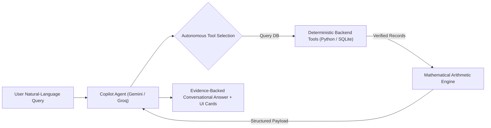

# Aerchain RFx Intelligence Platform
> **AI-Native Autonomous Sourcing & Commercial Comparison Engine for Enterprise Procurement**

[](https://aerchain-dashboard.vercel.app)
[](https://github.com/rakeshks2k/aerchain-assignment)
[](https://fastapi.tiangolo.com)
[](https://cloud.google.com)
[](tests/)

---

## 📌 Executive Overview

Enterprise packaging category buyers spend **3 to 9 days per RFx event** manually reading disparate supplier quotation formats — complex multi-sheet Excels, branded PDFs with buried footnote terms, narrative Word documents, mobile smartphone photos of printed rate cards, and terse informal emails.

**Aerchain RFx Intelligence** eliminates this friction with an end-to-end autonomous procurement workflow:

1. **AI-Assisted RFx Generation:** Generates comprehensive 30-item packaging schedules and 10 technical qualification criteria from natural-language category inputs.
2. **Multiformat Document Intelligence:** Ingests and parses 5 raw supplier file formats (**Excel `.xlsx`, PDF, Word `.docx`, Photographed Rate Card `.jpg`, and Email `.txt`**) with zero manual data entry.
3. **Automated Landed-Cost Normalization:** Normalizes non-standard units (per-sqm, per-kg, per-sheet) into standardized **INR landed cost per piece (excl. GST)**, accounting for volume discounts, freight terms, and statutory GST classifications.
4. **Unified Comparison Workspace:** A 30×5 sticky-header matrix with dynamic BRC food safety qualification filtering, visual confidence indicators, and provenance drill-down drawers.
5. **Conversational Procurement Analyst Copilot:** A genuine multi-turn autonomous LLM agent equipped with **10 deterministic backend tools** to answer complex commercial queries, calculate split-award allocations, audit fine print, and explain cost variances.
6. **Scenario Award Modeling & CSV Export:** Mathematical split-award optimization comparing best single-supplier contracts against multi-vendor allocations, producing audit-compliant CSV downloads.

---

## 🚀 Live Links & Quick Evaluation

| Resource | Link / Access | Notes |
|---|---|---|
| **Live Production Dashboard** | **[https://aerchain-dashboard.vercel.app](https://aerchain-dashboard.vercel.app)** | Instant access, zero login required |
| **GitHub Repository** | **[https://github.com/rakeshks2k/aerchain-assignment](https://github.com/rakeshks2k/aerchain-assignment)** | Clean Git history, documented codebase |
| **Evaluation Runbook** | **[`docs/demo-runbook.md`](docs/demo-runbook.md)** | Step-by-step 15-minute evaluation runbook |

---

## 🧠 Architectural & Engineering Rigor

### 1. Genuine Autonomous LLM Agent with Tool Calling
Unlike brittle demo prototypes that rely on hardcoded keyword matching or canned templates, the **Procurement Analyst Copilot** is a genuine reasoning agent:
- **Autonomous Tool Calling:** Powered by native function calling via **Google Gemini 2.5 / 3.1 Flash** (with instant drop-in support for **Groq Llama 3.3 70B** and **OpenAI GPT-4o**).
- **10 Deterministic Backend Analytical Tools:** The LLM decides *which* data it needs and invokes controlled backend functions to query SQLite and compute formulas.
- **Multi-Turn Conversational Memory:** Maintains full session context, allowing natural back-and-forth reasoning (e.g., *"Which supplier is cheapest?"* $\rightarrow$ *"What if we require BRC qualification?"* $\rightarrow$ *"What would a split award save us?"*).



### 2. Never Trust an LLM with Financial Arithmetic
LLMs are probabilistic token predictors prone to mathematical hallucinations. In enterprise procurement, a 1% arithmetic error on an ₹8.5 Crore spend represents ₹8,50,000 in false projections.
- All price normalization, landed cost calculations, volume discount tiers, statutory taxes, freight adjustments, supplier rankings, and split-award knapsack optimizations are computed by **deterministic Python functions**.
- The LLM's role is strictly analytical reasoning, interpretation, synthesis, and conversational explanation.

### 3. Enterprise Trust & Non-Hallucination Guardrails
Real-world supplier quotes are noisy, ambiguous, and non-standard. The platform enforces strict trust mechanisms:
- **RegionalPacks Co (RPC) Unresolved Handling:** In their submission email, RPC quoted 17 items and wrote *"rest same as last year, freight extra"*. Rather than hallucinating numbers, the engine marks the 13 lines as **`UNRESOLVED`** with a **`0.10 (10%)`** confidence score, alerting the buyer that no baseline contract exists on file.
- **EcoBox Solutions (EBS) Footnote Extraction:** EcoBox hid an 8% trade discount in fine-print footnote 1 on page 2 and quoted a 12% GST rate when statutory packaging GST is 18%. The ingestion pipeline captured the discount, applied it to normalize all 30 SKUs, and flagged the tax discrepancy for legal review.
- **Hard Quality Gates (BRC Food Safety):** A single toggle in the Comparison Workspace immediately eliminates non-BRC certified vendors (EBS and RPC), instantly updating the competitive landscape.
- **Immutable Audit Trail & Manual Overrides:** Every system event is written to an immutable audit ledger (`audit_log`), and buyers can execute manual overrides with logged rationale and provenance tracking.

---

## 📊 The Sourcing Event Dataset (Corrugated Packaging)

The platform includes a real-world enterprise sourcing event for **30 Corrugated Packaging SKUs** across **5 distinct suppliers**:

| Supplier Code | Supplier Name | Response Format | Coverage | BRC Certified? | Key Commercial Nuance Extracted |
|---|---|---|:---:|:---:|---|
| **PKI** | **PackIndia Ltd** | **Excel (`.xlsx`)** | 28 / 30 | **YES (Grade A)** | Items 12 & 13 quoted per sq. meter (normalized to per-piece); Item 18 quoted "On Request"; Freight included for orders >₹50,000. |
| **EBS** | **EcoBox Solutions** | **PDF Document** | 30 / 30 | **NO (Audit Q1'27)** | **8% trade discount hidden in footnote 1**; claims 12% GST (flagged for review); Ex-Works freight (+₹1.20/pc). |
| **IPI** | **IndoPack Industries** | **Word (`.docx`)** | 29 / 30 | **YES** | Quoted Ex-Factory Chennai + ₹2.50/kg freight; Item 29 submitted as an **E-flute substitute** proposal requiring QA review. |
| **PCO** | **PremiumCorrugated** | **Photo (`.jpg`)** | 30 / 30 | **YES (Grade AA)** | Smartphone photo of printed rate card (perspective distortion, noise); tiered 7% volume discount extracted and applied. |
| **RPC** | **RegionalPacks Co** | **Email (`.txt`)** | 17 / 30 | **NO** | Quoted 17 items; remaining 13 items written as *"rest same as last year"*; flagged **UNRESOLVED (`0.10`)** with zero baseline. |

---

## 🎯 5-Minute Interactive Product Walkthrough

To experience the depth and polish of the autonomous sourcing workflow, follow this 5-step path:

### Step 1: Submissions & Multiformat Ingestion
1. Navigate to the **Submissions** tab.
2. Observe all 5 distinct formats: Excel, PDF, Word, JPG, and Email.
3. Click the three dots `•••` $\rightarrow$ **Inspect Quotes** on **RegionalPacks Co (RPC)**:
   - Notice the **72% Extraction Accuracy** (`Review Needed`) KPI card.
   - Look at the **Extraction Exceptions & Unresolved Items** callout.
   - In the quotes table, observe the 13 lines marked with the bold orange **`UNRESOLVED`** badge and the red **`0.10 (10%)`** confidence badge, with the verbatim email citation: *"rest same as last year, freight extra"*.

### Step 2: The Comparison Workspace (Normalization Matrix)
1. Click **Comparison Workspace** in the left sidebar.
2. Scroll through the **30×5 sticky matrix** — all prices normalized to true landed cost per piece in INR.
3. Click the **"BRC Qualified Only"** toggle switch in the toolbar:
   - Instantly, EcoBox Solutions and RegionalPacks Co are greyed out across all 30 SKUs with disqualification badges.
4. Click any price cell (e.g., Item #1 for PackIndia):
   - The **Quote Audit & Provenance** side panel slides out, displaying original rate, base rate, trade discounts, freight additions, GST, and document citations.

### Step 3: Conversational Procurement Analyst Copilot
1. Click **Procurement Copilot** in the left sidebar.
2. Try asking complex multi-turn questions:
   - **Question 1:** *"Which supplier is the cheapest across all line items?"*
     *(Notice the Copilot invokes `compare_supplier_prices`, runs deterministic SQL calculations, and explains that while EcoBox and RegionalPacks have lowest raw rates on 28 items, neither has BRC certification and both have major commercial exceptions).*
   - **Question 2 (Multi-Turn Follow-Up):** *"What if we restrict our award strictly to BRC food-grade qualified suppliers?"*
     *(Without losing conversation context, the Copilot invokes `filter_qualified_suppliers` and re-evaluates the landscape across PKI, IPI, and PCO).*
   - **Question 3:** *"What would happen if we split the order across the cheapest qualified suppliers?"*
     *(The Copilot runs `calculate_split_award_scenario`, compares single-source against multi-vendor award, and quantifies exact rupee savings).*
   - **Question 4:** *"What quotation exceptions, footnotes, or audit risks were flagged across all submissions?"*
     *(The Copilot synthesizes the footnote discount from EBS, the unresolved lines from RPC, the substitute board from IPI, and the missing rate from PKI).*

### Step 4: Scenario Award Modeling & CSV Export
1. Click **Award & Scenario Modeling** in the left sidebar.
2. Compare the **Best Single Qualified Supplier** against the **Optimal Split Award Scenario**.
3. Click **"📊 Export Comparison CSV"** or **"📄 Download Award Summary"** to verify audit-compliant tabular export.

---

## 🛠️ Technical Architecture & Stack

```
aerchain-assignment/
├── api/
│   └── index.py                 # Vercel serverless entrypoint with /tmp DB bridge
├── backend/
│   ├── ai_service.py            # AI ingestion pipeline & heuristic parsing fallback
│   ├── copilot_agent.py         # Autonomous Copilot agent with function calling & history
│   ├── copilot_tools.py         # 10 deterministic backend analytical tools & SQL engine
│   ├── database.py              # Async SQLite persistence layer (aiosqlite)
│   ├── main.py                  # FastAPI REST routes, validation, & audit logging
│   ├── security.py              # Security headers, rate limiting, RBAC, input sanitization
│   ├── seed_data.py             # Deterministic seed data generator (30 SKUs, 5 vendors)
│   └── data/
│       └── aerchain.db          # SQLite pre-seeded enterprise database
├── frontend/
│   ├── index.html               # Semantic HTML5 SPA layout
│   └── static/
│       ├── app.js               # Enterprise SPA controller (Vanilla ES6+)
│       └── style.css            # Aerchain design system (tokens, responsive layout)
├── public/                      # Static production mirror for Vercel CDN
├── supplier_docs/               # Raw mock supplier submission files (.xlsx, .pdf, .docx, .jpg, .txt)
├── tests/                       # 65 automated pytest suites (unit, security, tools, copilot)
├── docs/
│   └── demo-runbook.md          # 15-minute evaluation runbook with anticipated questions
├── requirements.txt             # Python dependencies
└── vercel.json                  # Vercel production routing & serverless configuration
```

### Technology Matrix
- **Backend:** Python 3.10+, FastAPI, `aiosqlite`, `openpyxl`, `PyPDF2`, `python-docx`, `Pillow`, `fpdf2`.
- **AI Agent:** Google Generative AI (`google-generativeai` 0.8.4), Groq Cloud API (`groq`), OpenAI SDK.
- **Frontend:** Vanilla JavaScript (ES6+ Modules, zero compilation latency), Chart.js 4.4, Modern CSS Custom Properties.
- **Deployment:** Vercel Serverless Functions (`python3.12`), Vercel Edge CDN for static assets.

---

## 💻 Local Setup & Development

### 1. Clone the Repository
```bash
git clone https://github.com/rakeshks2k/aerchain-assignment.git
cd aerchain-assignment
```

### 2. Set Up Virtual Environment & Dependencies
```bash
python -m venv venv
# On Windows:
.\venv\Scripts\activate
# On macOS / Linux:
source venv/bin/activate

pip install -r requirements.txt
```

### 3. Configure Environment Variables
Copy the template configuration file:
```bash
cp .env.example .env
```
Open `.env` and add your Gemini, Groq, or OpenAI API key:
```env
GOOGLE_GENERATIVEAI_API_KEY=your_gemini_api_key_here
GEMINI_API_KEY=your_gemini_api_key_here
GEMINI_MODEL=gemini-2.5-flash
# Optional: GROQ_API_KEY=gsk_your_groq_key_here
```
*(Note: If no API key is provided, all 10 deterministic backend tools, calculations, and database queries still function normally).*

### 4. Run the Local Development Server
```bash
python -m uvicorn main:app --app-dir backend --reload --port 8000
```
Open your browser at **`http://localhost:8000`**.

---

## 🧪 Automated Testing & Verification

The project includes **65 automated tests** across 5 test suites verifying security, tool accuracy, agent behavior, and regression boundaries:

```bash
pytest tests/ -v
```

### Test Coverage Highlights:
- **`tests/test_copilot_agent.py`:** Validates agent initialization, function calling, tool execution loops, context memory, and graceful API degradation.
- **`tests/test_copilot_tools.py`:** Validates all 10 deterministic analytical tools (landed costs, split-award knapsack logic, BRC filtering, variance analysis).
- **`tests/test_security.py`:** Tests SQL injection prevention, path traversal defense, file upload validation, prompt injection immunity, rate limiting, and RBAC permissions.
- **`tests/test_functional_regression.py`:** Verifies calculations against independently verified ground truth numbers.
- **`tests/test_final_acceptance.py`:** Verifies full end-to-end user workflows from RFx dispatch to award export.

---

## 🔒 Security & Enterprise Readiness

- **Role-Based Access Control (RBAC):** Simulated authentication supports `BUYER`, `ANALYST`, `AUDITOR`, and `ADMIN` roles with granular permission checks.
- **SQL Injection Immunity:** 100% parameterized SQLite queries via `aiosqlite` with zero dynamic string interpolation.
- **File Upload Protection:** Strict MIME type validation, file size limits (15MB), filename sanitization, and path traversal prevention.
- **Prompt Injection Defense:** Supplier documents are isolated as untrusted data envelopes with XML tags and system prompt boundaries to prevent model hijacking.
- **Rate Limiting & Security Headers:** Integrated middleware applying CSP, HSTS, X-Content-Type-Options, and IP-based rate limiting (60 req/min).

---

## 👤 Author & Contact

**Rakesh K S**  
- **Email:** [rakesh27242@gmail.com](mailto:rakesh27242@gmail.com)  
- **GitHub:** [@rakeshks2k](https://github.com/rakeshks2k)  
- **Project Repository:** [https://github.com/rakeshks2k/aerchain-assignment](https://github.com/rakeshks2k/aerchain-assignment)  
- **Live Deployment:** [https://aerchain-dashboard.vercel.app](https://aerchain-dashboard.vercel.app)
